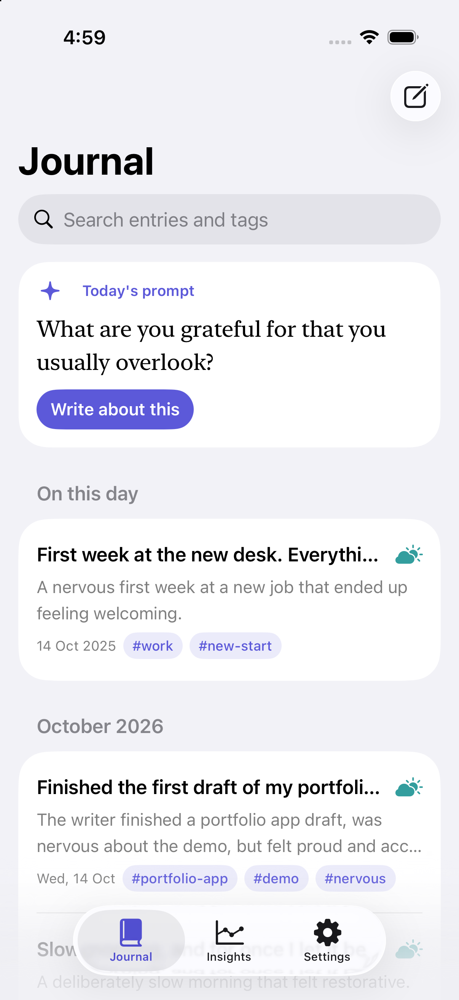
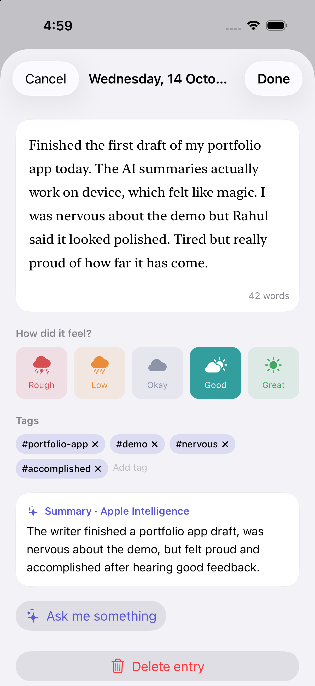
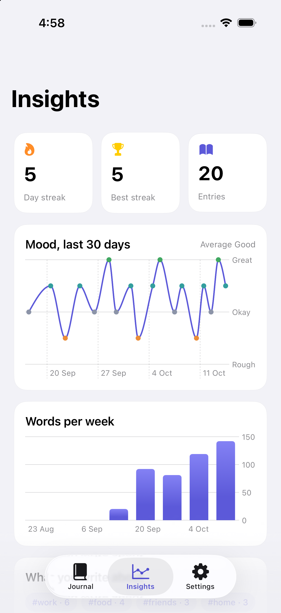
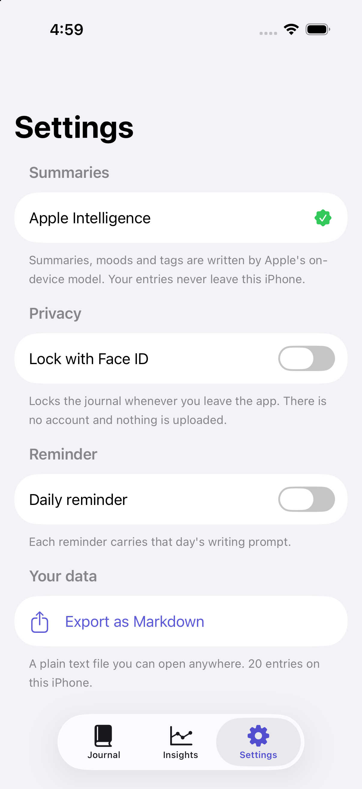

# Inkling

A private journal for iPhone that summarises what you write, on the device. Apple's on-device language model reads each
entry and suggests a short summary, a mood and a few tags, and can ask you a follow-up question. There is no account, no
server and no network code: your writing never leaves the phone.

<table>
  <tr>
    <td></td>
    <td></td>
    <td></td>
    <td></td>
  </tr>
</table>

Screenshots use sample entries seeded by a Debug-only launch argument. The editor shows an entry written and summarised
on the simulator.

## What it does

- **Summary, mood and tags** for each entry, written by the Foundation Models framework and returned as a typed
  `@Generable` struct, so there is no text parsing.
- **Works without Apple Intelligence.** If the model isn't available (older iPhone, feature off, model still
  downloading) it falls back to NaturalLanguage sentiment and a keyword tagger. Settings says which one is in use.
- **"Ask me something"**: two gentle follow-up questions about an entry (only when the real model is available).
- **Insights** with Swift Charts: day streak, best streak, 30-day mood trend, words per week, most-used tags.
- **Daily prompt**, and an **On this day** section that brings back entries from earlier years.
- **Face ID lock** that re-locks when you leave the app and hides the app-switcher snapshot.
- **Daily reminder** that carries that day's prompt.
- **Search** across text and tags, ignoring case and accents.
- **Siri / Shortcuts**: "New entry in Inkling" via an App Intent.
- **Export** the whole journal as a plain Markdown file.

## What it shows

| Area | Where |
| --- | --- |
| Foundation Models: `@Generable`, `@Guide`, availability handling, prompt and instruction design | [InsightEngine.swift](Inkling/Data/InsightEngine.swift) |
| Graceful degradation (NaturalLanguage sentiment and keyword fallback) | same file, `basicInsight` |
| Not clobbering the user: AI never overwrites a mood or tags you set yourself, and stale results are dropped if you edit while it thinks | `JournalEntry` flags, `InsightEngine.analyze` |
| SwiftData model and `@Query` | [JournalEntry.swift](Inkling/Data/JournalEntry.swift) |
| LocalAuthentication lock with passcode fallback | [AppLock.swift](Inkling/Data/AppLock.swift) |
| Local notifications scheduled per day with different content | [Reminders.swift](Inkling/Support/Reminders.swift) |
| Swift Charts | [InsightsView.swift](Inkling/UI/InsightsView.swift) |
| Custom `Layout`, `Transferable` file export, App Intents | [Theme.swift](Inkling/Support/Theme.swift), [SettingsView.swift](Inkling/UI/SettingsView.swift), [QuickWrite.swift](Inkling/Support/QuickWrite.swift) |
| Pure logic in a tested package | `Packages/InklingCore`, 30 tests |

## Requirements

Xcode 26 or later and iOS 26, because Foundation Models needs it. Apple Intelligence is optional at runtime.

## Build

```bash
brew install xcodegen
xcodegen generate
open Inkling.xcodeproj
```

Run the logic tests with `cd Packages/InklingCore && swift test`.

For screenshots, a Debug build accepts `-demo` (fill an empty journal with a month of entries), `-demoReset` (wipe
first) and `-demoTab 0|1|2`.

## Layout

```
Inkling/                 App target: Data/ (model, AI, lock), UI/, Support/, Dev/ (Debug-only demo data)
Packages/InklingCore/    Moods, streaks, trends, tags, search, prompts, Markdown export. No UI, runs with `swift test`
project.yml              XcodeGen definition; the .xcodeproj is generated and not committed
```

## Known limits

- Entries are stored on the device only. There is no iCloud sync yet, so deleting the app deletes the journal; use
  Export to keep a copy.
- The language model has a small context window, so very long entries are summarised from their start and end.
- Summaries are in whatever language the on-device model supports for the device's settings.
